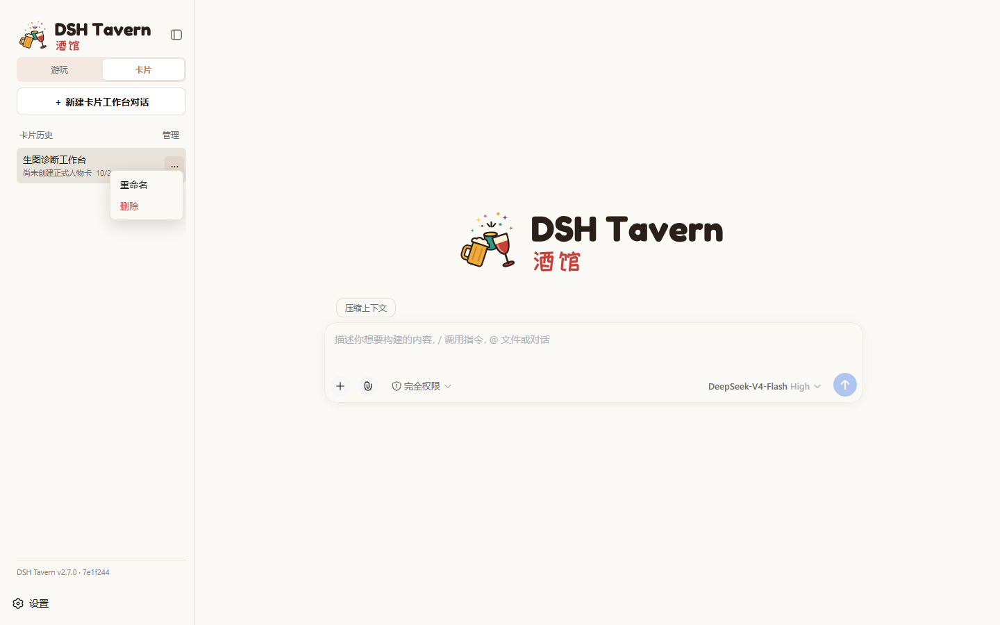
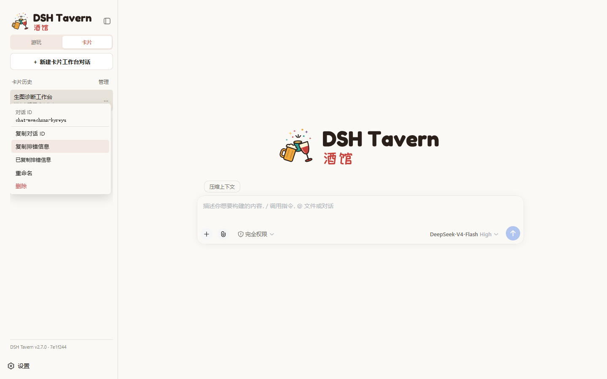
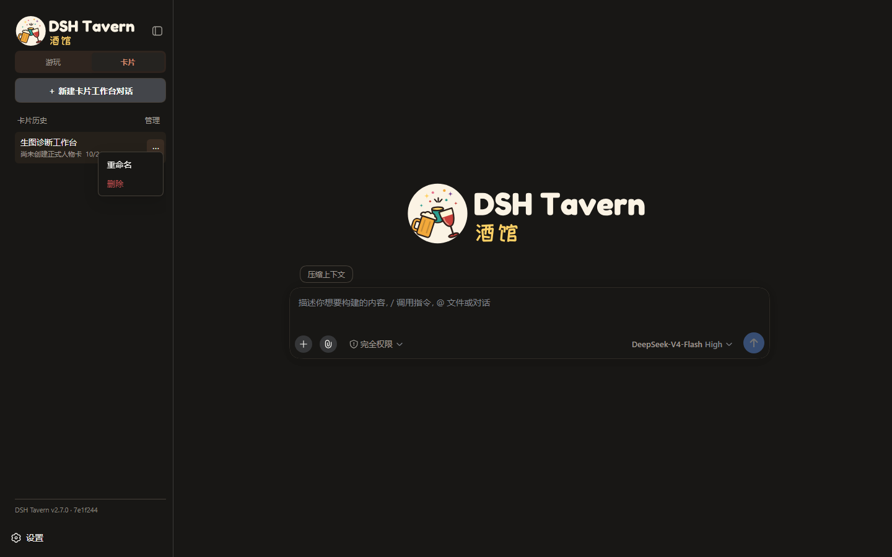
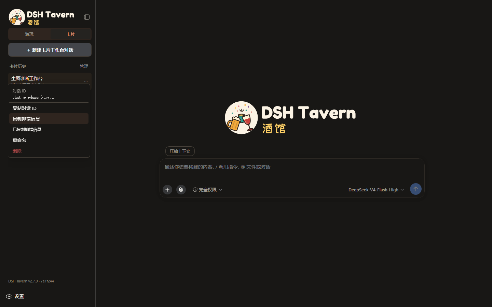
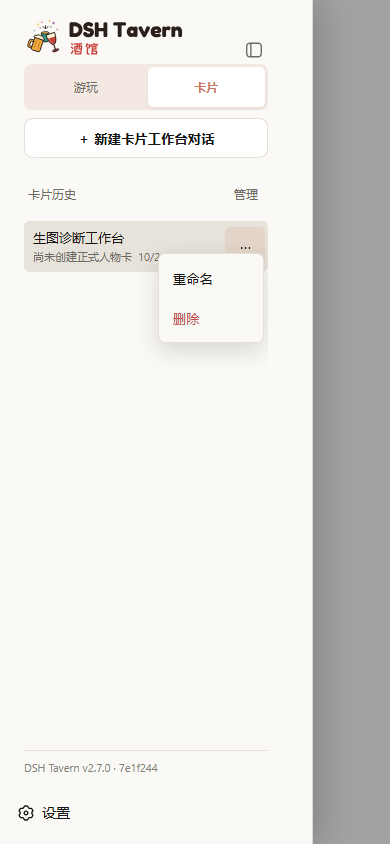
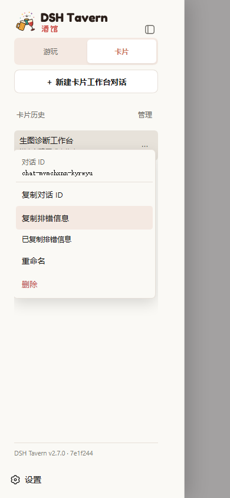
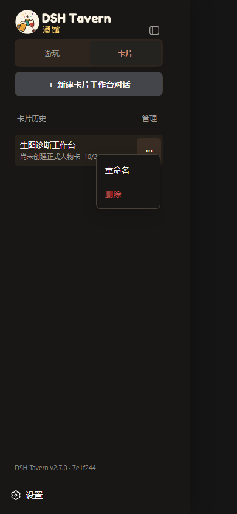
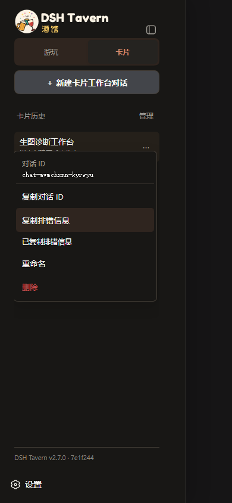

# 对话 ID 与生图诊断

设计稿：https://www.figma.com/design/2orsAQMkp7TPBMS8KY6kyD

用户已确认菜单方案，随后明确要求按特殊要求免 PR 直接合入主分支；AGENTS.md 已记录此例外规则。

每条卡片或游玩对话的“⋯”菜单显示稳定对话 ID，可复制完整 ID 或排错信息（对话 ID、Session ID、轮次，以及该轮有记录的最新生图请求和生图 Agent ID）。复制成功反馈，权限失败提供可选择文本。查询接口只返回身份字段，不包含剧情或凭据。

## 验证

- 实际运行的 Tavern + Chromium，真实对话身份 RPC 与剪贴板检查。
- 桌面 1440×900、手机 390×844；浅色、暗色及 abyss 主题。
- 截图时仅展示两条已有对话并替换为中性标题，避免泄露历史标题；没有发送模型或生图请求。
- 生图 Agent 诊断工具另经真实 DSH 子会话、规划、受控本地 HTTP 图片服务和附件保存验证；没有测试外部供应商画面质量。
- 相关测试：play-image-debug、play-chat-debug、scene-plan、scene-tag-filter、card-visual-references、scene-character-looks、skill-gated-tools，共 17 项通过。

## 界面对比

| 状态 | 修改前 | 修改后 |
|---|---|---|
| 桌面浅色 |  |  |
| 桌面暗色 |  |  |
| 手机浅色 |  |  |
| 手机暗色 |  |  |

完整检查结果见 verification.json。浏览器脚本：tests/browser/conversation-identity-browser-smoke.mjs，可通过 TAVERN_UI_BASELINE_SOURCE 指向当前运行的旧源码目录，对比未部署的客户端。

## 生图测试边界

卡片 Agent 加载 debug-card 后可读取关联游玩日志，调用正式生图链路并查看结果图片。每个工作台最多提交 5 个不同请求，重复请求沿用 requestId，失败不自动换编号重试。测试图片保留在原游玩的版本中，不是独立沙盒。截图和链路测试不构成“外部生图稳定”的结论。
