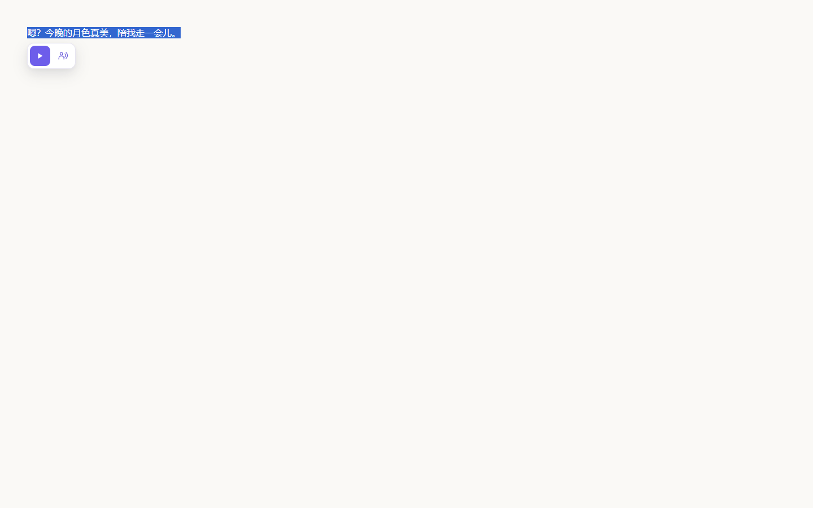
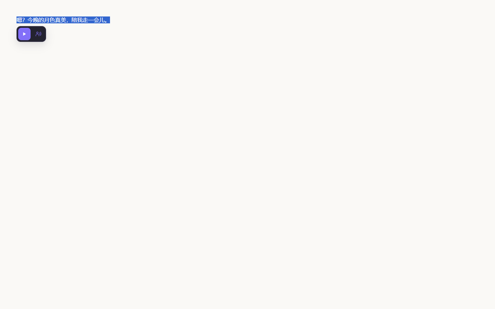
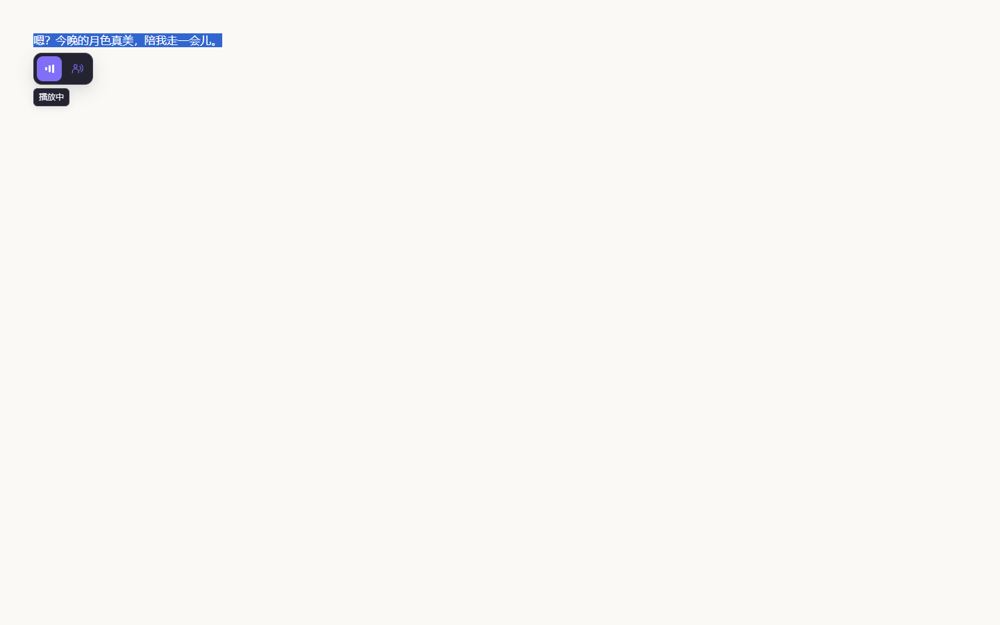
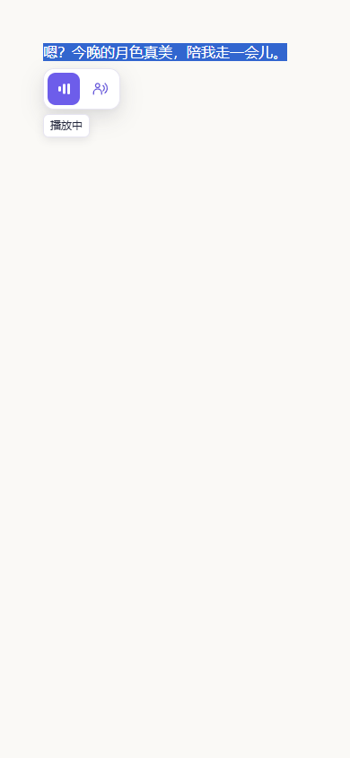
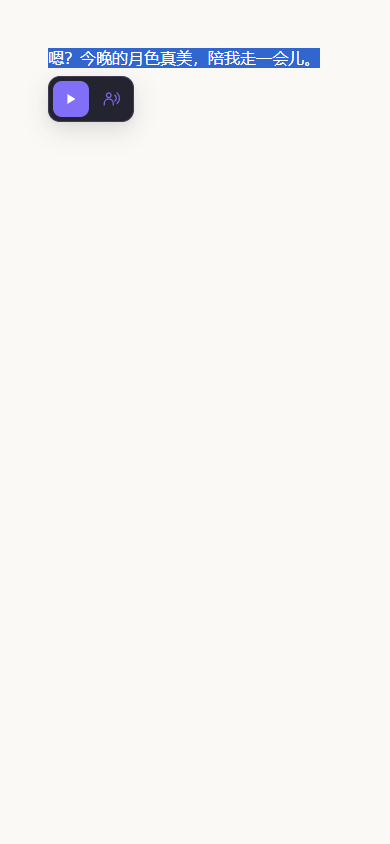
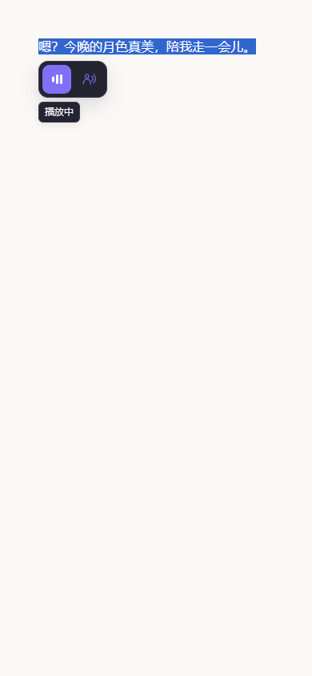

# 音色偏好与播放反馈

[Figma 前后对比](https://www.figma.com/design/w9IjLRAzP3WpJxhga6P22f?node-id=28-3)

两图均为真实隔离浏览器扩展播放中状态，使用相同示例句与本地 fixture 音频。保留双图标尺寸及现有配色。

- 切换音色自动保存，同步浮条、弹窗及其他页面。
- 播放中使用动态音柱，排队时钟，完成勾号；2.2 秒轻提示不撑宽浮条。
- 多次点击仍逐条播放；新排队项不会遮掉当前播放状态。
- 短句缓存保留标点，问句与感叹句分开缓存；原文不改写。
- 后台发送请求前等待音频页就绪，避免启动期间丢失消息。

| 场景 | 原来 | 修改后 |
|---|---|---|
| 桌面浅色 1440×900 |  |  |
| 桌面深色 1440×900 |  |  |
| 窄屏浅色 390×844 |  |  |
| 窄屏深色 390×844 |  |  |

验证：`npm test --prefix browser-extensions/local-voice`；测试覆盖跨页面偏好、真实 Audio 播放状态、排队、短句标点缓存隔离、白名单与现有缓存行为。
