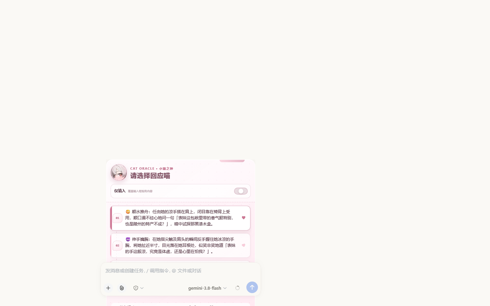
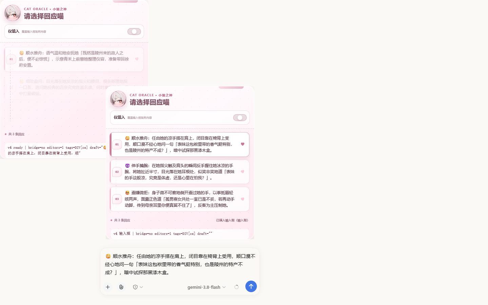
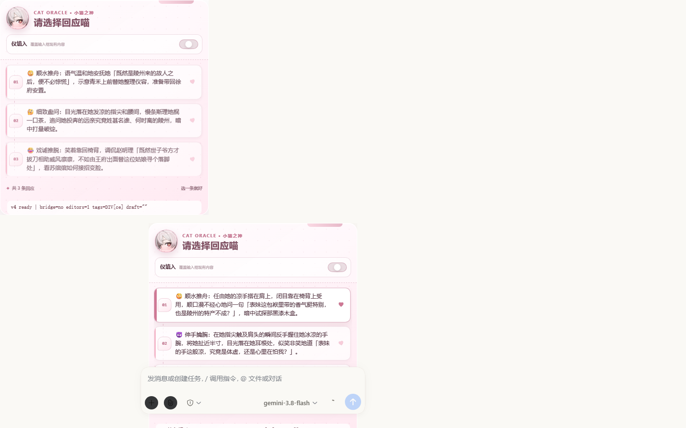
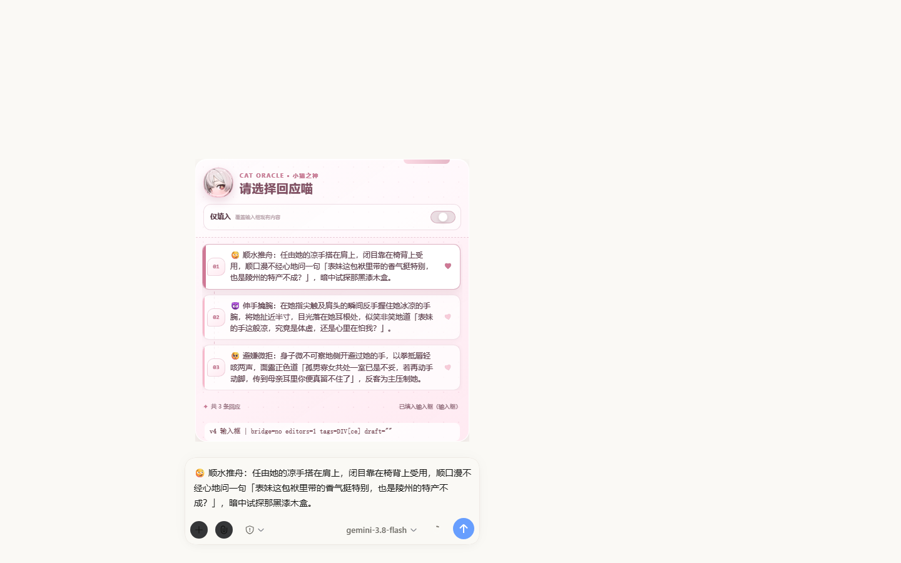
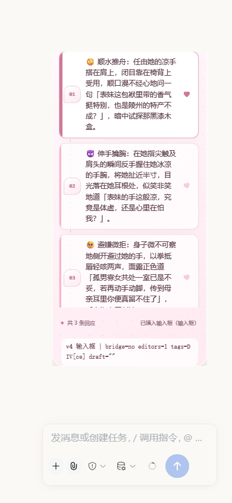
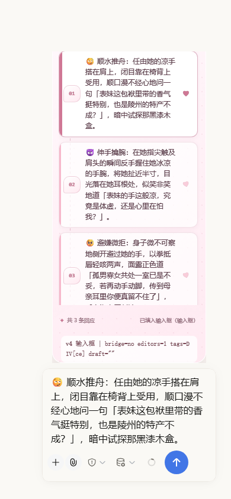
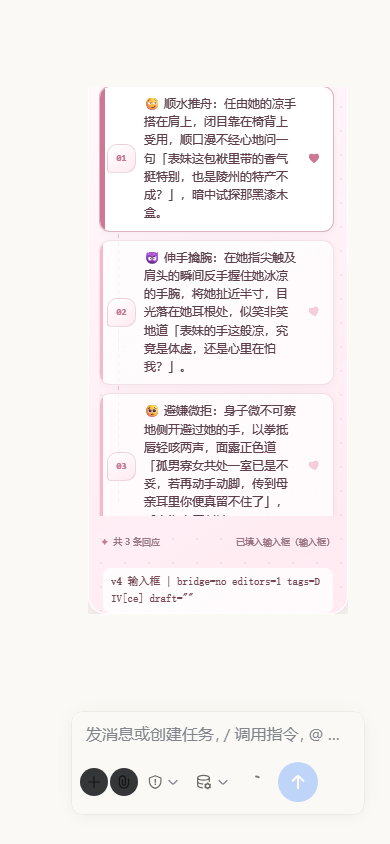
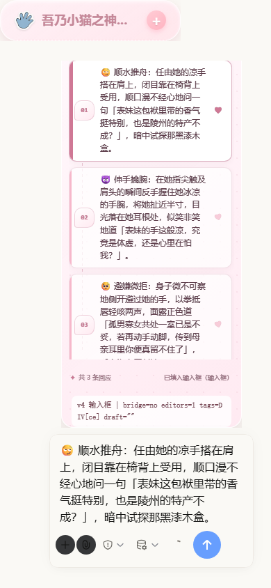

# 回复填入回归验证

真实本地酒馆页面，Reborn2.4.2 回复面板；截图隐藏了无关的会话列表与正文。

- 修复前：浏览器响应中移除本次新增的兼容输入框 `input` 监听器，复现原行为；点击后隐藏框有文字，可见草稿为空。
- 修复后：加载本地构建，点击同一回复，可见草稿与选项文本完全一致。
- 两组均使用已更新为“仅填入”的本地预设，以隔离比较输入同步行为。
- 桌面为 1440×900，手机为 390×844；暗色通过宿主 `data-ds-dark-theme` 属性切换。预设自带粉色面板保留原配色。
- 没有提交模型消息；验证结束恢复原草稿。直接发送及旧卡片隔离另有自动化测试覆盖。
- 本次用户明确允许跳过设计稿，保持原外观。

| 场景 | 修复前 | 修复后 |
|---|---|---|
| 桌面浅色 |  |  |
| 桌面暗色 |  |  |
| 手机浅色 |  |  |
| 手机暗色 |  |  |

测试：`node --test tests/legacy-composer.test.mjs tests/card-runtime-lifecycle.test.mjs tests/helper-slash-compatibility.test.mjs tests/inline-message-renderer.test.mjs tests/opening-slash.test.mjs`，26 项通过；客户端构建及产物一致性检查通过。

仓库测试入口在当前 Windows 环境的 `--import C:\...` 参数上报 `ERR_UNSUPPORTED_ESM_URL_SCHEME`，上述前端测试直接使用 Node test runner 执行。
