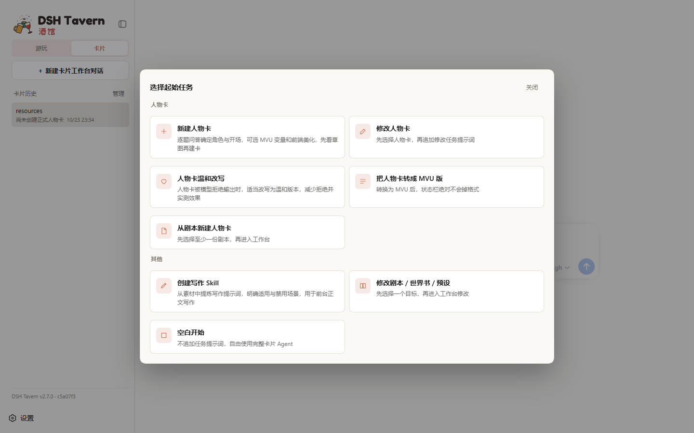
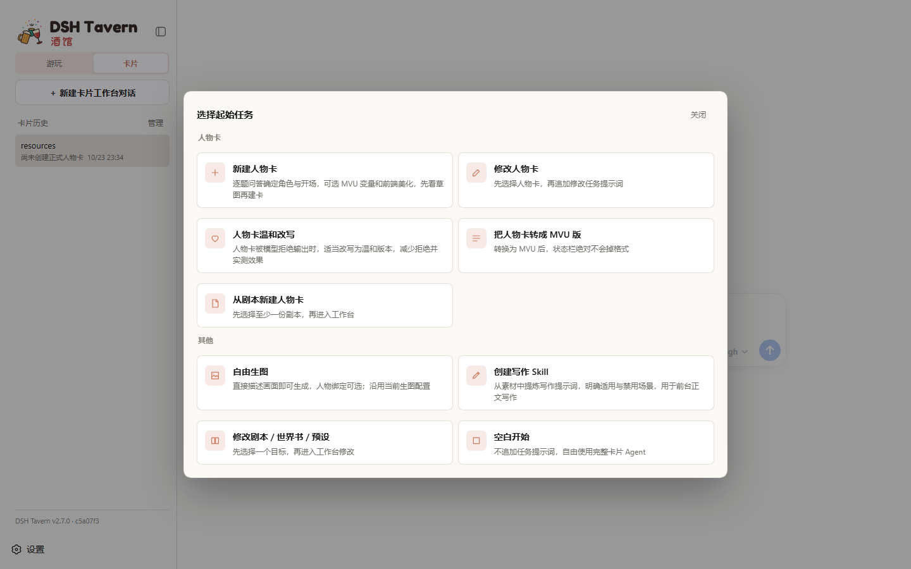
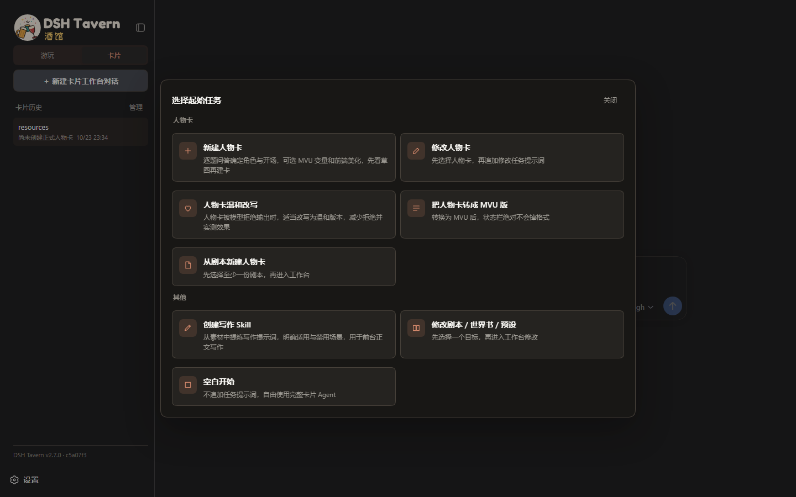
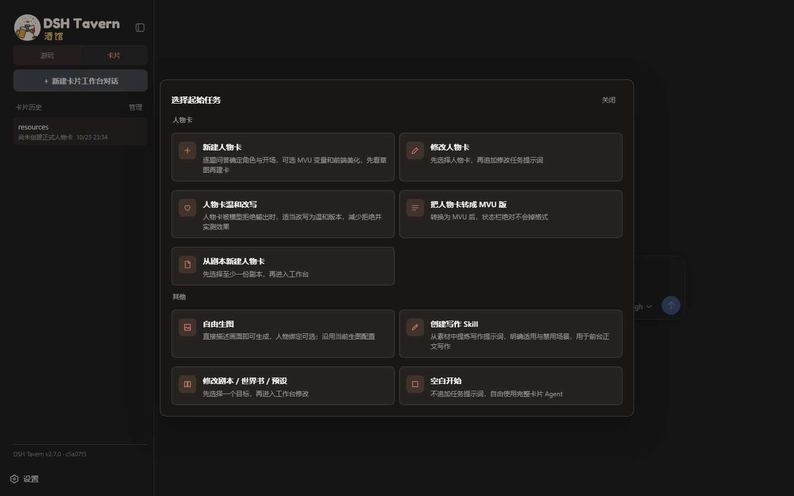
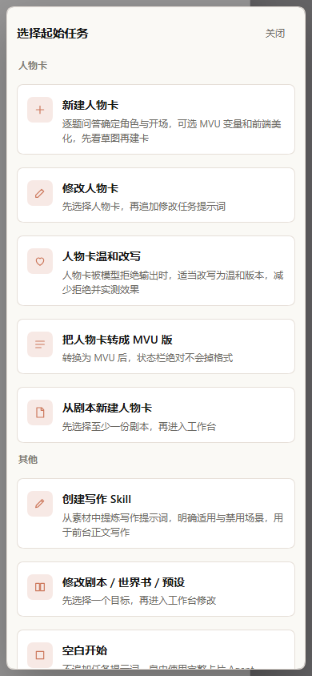
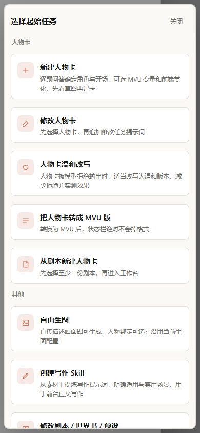
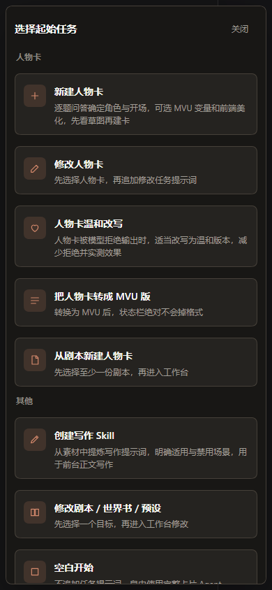
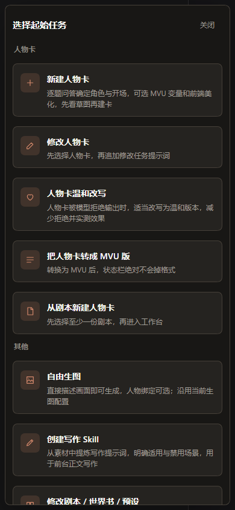

# 工作台自由生图

设计方向已确认：[Figma 设计样板](https://www.figma.com/design/4fEGIMWbtmwJTvi8GphsTP)。

新增「自由生图」任务入口；所有已有工作台都可不绑定人物直接生成图片。只有用户明确要求时才使用人物参考保存流程。画风读取全局偏好，不预设日系、写实等风格；用户配置的人物 LoRA 保持不变。

## 界面验证

截图来自真实本地 DSH 隔离实例。改前使用 origin/main 的完整客户端包，改后使用本分支构建产物；同一实例、相同任务选择器状态，未模拟接口或重绘界面。桌面 1440×900，手机 390×844。

| 场景 | 改前 | 改后 |
|---|---|---|
| 桌面浅色 |  |  |
| 桌面暗色 |  |  |
| 手机浅色 |  |  |
| 手机暗色 |  |  |

另测 Abyss 主题：[桌面](desktop-abyss-after.png)、[手机](mobile-abyss-after.png)。新增卡片使用已有组件与主题变量，无新样式或固定颜色。任务数量增加后手机内容区可滚动，弹窗未横向溢出。

实际点击入口创建了未绑定人物卡的工作台，预填任务说明，输入框可继续编辑：[工作台截图](free-image-workbench.png)。自动化记录见 [verification.json](verification.json)，浏览器验证逻辑见 `tests/browser/workbench-image-browser-smoke.mjs`，导出 `verify(authenticatedLocalUrl)` 供隔离实例启动器调用。认证 URL 仅在内存中传递。

## 功能验证

- 相关测试共 25 项通过：`workbench-image`、`card-visual-references`、`card-reference-image-view`、`scene-image-style`、`scene-image-comfy`、`card-system-prompt`、`workspace-instruction-presentation`、`conversation-initialization`。
- 覆盖空白及已绑定工作台、真实本地 HTTP 请求、图片落盘、取消与失败不自动重试、工具权限、图片精简展示，以及画风偏好为空／自动／锁定与人物 LoRA 保留。
- 使用当前实际 ComfyUI 服务和原人物 LoRA 配置，在未绑定人物卡的会话上下文调用新工具，成功生成并保存灯塔图片。该验证直接运行工具与服务链路，不宣称完成了真实文字模型自主选工具的端到端测试。
- `node bin/build-tavern-client.mjs --check`、`git diff --check` 通过。

测试启动器在 Windows 的 `--import` 绝对路径处理上报 `ERR_UNSUPPORTED_ESM_URL_SCHEME`，本次相关文件使用 `node --test tests/<文件>.test.mjs` 运行，未跑全量。额外检查发现 `node bin/build-plugin-package.mjs --check` 报 `plugin.patch.yml 已过期`，原始 main 上同样失败；该既有问题未混入本次功能改动。
