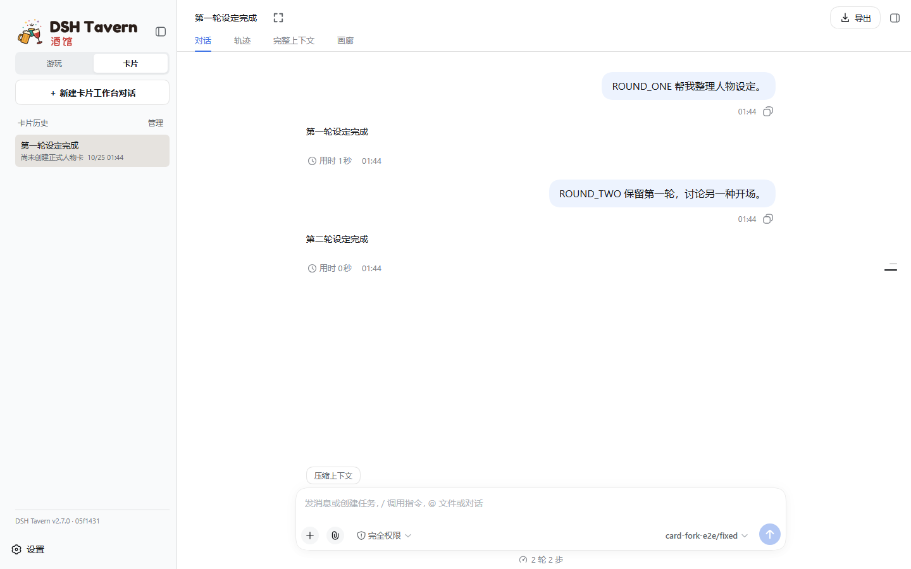
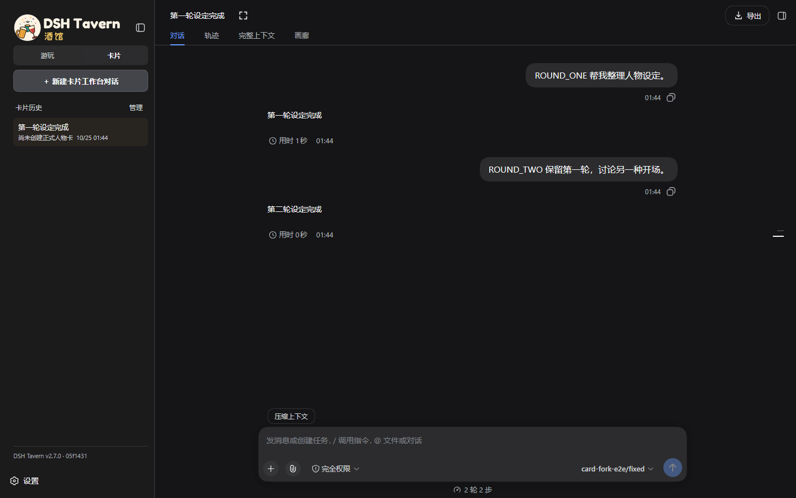
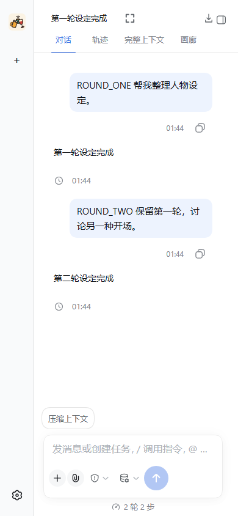
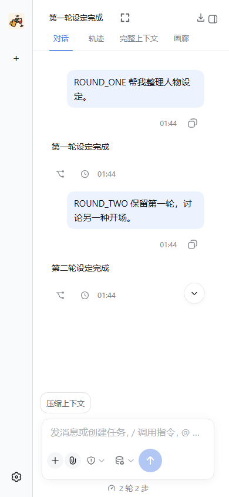
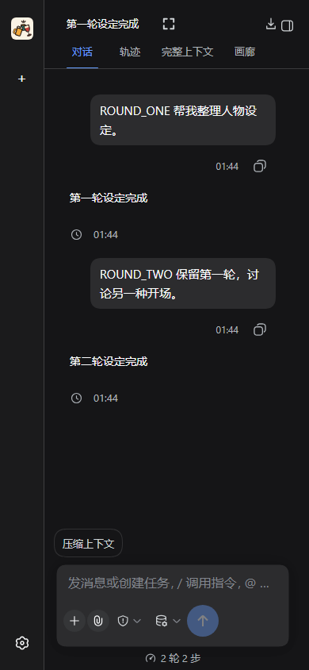
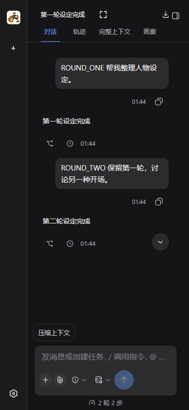

# 卡片工作台对话分支验收

设计稿：[卡片对话开分支](https://www.figma.com/design/72PgDz0Q5HpsWg8StQIEit?node-id=2-3)。

## 行为

- 在卡片模式已完成回复的操作栏中复用游玩的「从这一轮分叉」入口。
- 新 Session 截止在所选回合的原生完成边界，新 Chat 保持卡片模式并保存该回合的工作台状态；原对话保留。
- 新标题追加「· 分支」，分支仍可继续写卡并再次分支。
- 清除分支中的未提交卡片修改和待处理素材窗口；保留工作台草稿、素材引用与设置的独立副本。
- 取消宿主在分叉边界之后继承的排队输入，防止继续分支时自动重放原对话的后续请求。
- 旧记录从成功提交记录补齐轮号，通过存档修订恢复历史工作台；缺少所需快照时拒绝分支。
- 这是对话分支。已绑定的人物卡、世界书、预设等库文件仍是原来的资源，不按聊天回合回滚或另建副本。

## 已执行验证

- 25 项针对性测试通过：卡片分支、旧记录兼容、历史回合恢复、排队输入隔离、回合提交、快照保留、游玩分支回归和命名同步。
- `node bin/build-tavern-client.mjs --check` 通过；`git diff --check` 通过。
- 当前本地实例重启后，实际确认旧卡片对话的回复按钮可见，并成功调用原生分支、绑定卡片 Chat、自动命名和打开新对话。
- 本地试用沿用现有暖色主题；独立浏览器验收使用宿主默认主题，覆盖桌面 1440×900、手机 390×844 和浅色／暗色。

针对性测试命令：

```sh
node --test tests/card-conversation-fork.test.mjs tests/conversation-fork.test.mjs tests/conversation-fork-point.test.mjs tests/conversation-fork-targets.test.mjs tests/turn-orchestration.test.mjs tests/conversation-compaction.test.mjs tests/conversation-rename.test.mjs
node tests/e2e/card-conversation-fork.mjs
```

当前 Windows 环境中 `bin/test-tavern.mjs` 的 `--import C:\...` 参数会被 Node 当成不支持的 URL scheme；上述同一组测试使用 `node --test` 直接执行。

## 浏览器验收

独立 DSH 使用隔离数据目录和固定模型输出，原生 Session、RPC、持久化和浏览器交互均走真实实现。改前截图使用原来的前端显示条件重新加载同一份测试对话，不用 CSS 隐藏按钮模拟。

验收脚本创建两轮卡片对话，从第一轮建立分支，继续生成、刷新验证，最后从继承历史再次分支。四项检查全部通过，见[验收报告](card-conversation-fork-2026-10-25.json)。

| 状态 | 改前 | 改后 |
|---|---|---|
| 桌面浅色 1440×900 |  |  |
| 桌面暗色 1440×900 |  |  |
| 手机浅色 390×844 |  |  |
| 手机暗色 390×844 |  |  |
